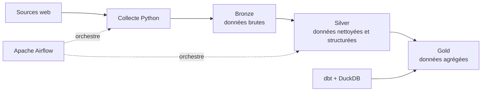

# Rugby Data Platform

> Une plateforme de data engineering pour collecter, transformer et préparer des données statistiques de rugby à l'aide de Python, Apache Airflow, dbt et DuckDB.

Ce projet personnel explore la construction d'un pipeline de données de bout en bout autour de plusieurs compétitions de rugby. Il couvre la récupération des calendriers, des effectifs et des joueurs par match, puis la préparation de statistiques exploitables selon une architecture médaillon.

## Vue d'ensemble

Les traitements sont organisés en étapes distinctes : Airflow orchestre les tâches, Python collecte et prépare les données, puis dbt et DuckDB contribuent à leur transformation et à leur agrégation.



### Étapes du pipeline

1. **Collecter** les calendriers, les effectifs et les données de joueurs et de matchs depuis des sources web.
2. **Conserver** les données récupérées dans la zone Bronze.
3. **Nettoyer et structurer** les données dans la zone Silver avec des traitements Python.
4. **Transformer et agréger** les données avec dbt et DuckDB pour préparer la zone Gold.
5. **Orchestrer** les traitements et leurs dépendances avec des DAGs Apache Airflow.

Les dossiers de données sont séparés par environnement (`DEV`, `INT`, `AP`, `PROD`). Les chemins sont définis dans `src/config.py` et peuvent être sélectionnés avec la variable `RUGBY_ENV` dans les traitements Python.

## Périmètre fonctionnel

Le dépôt contient des traitements autour de plusieurs sujets :

- calendriers de compétitions ;
- effectifs des équipes ;
- joueurs associés aux matchs ;
- statistiques individuelles de joueurs ;
- transformations Bronze → Silver → Gold.

Les DAGs de statistiques prévoient notamment les compétitions suivantes : Top 14, Pro D2, Premiership, Champions Cup, Challenge Cup et United Rugby Championship (URC). Les DAGs sont configurés pour être déclenchés manuellement ; leur disponibilité opérationnelle dépend de la configuration Airflow et des sources utilisées.

## Technologies

| Domaine | Outils |
|---|---|
| Langage et transformations | Python, pandas |
| Collecte web | Requests, Beautiful Soup |
| Orchestration | Apache Airflow |
| Modélisation analytique | dbt Core, dbt-duckdb, DuckDB |
| Qualité du code et tests | Ruff, pytest |
| Exécution reproductible | Docker, GitHub Actions |

## Démarrer avec Docker

Le dépôt fournit une image Docker contenant Airflow, le code du projet et un environnement dbt séparé.

```bash
docker build -t rugby-data .
mkdir -p data
docker run --rm -p 8080:8080 \
  -e AIRFLOW_VAR_ENV=DEV \
  -v "$PWD/data:/Volumes/rugby_data" \
  rugby-data airflow standalone
```

L'interface Airflow est ensuite accessible à l'adresse `http://localhost:8080`. Le montage conserve les données de l'environnement `DEV` dans le dossier local `data/`.

> **Configuration :** les chemins de données du projet sont définis à partir de `/Volumes/rugby_data` dans `src/config.py`. Si tu changes le point de montage Docker ou exécutes le projet hors de ce conteneur, adapte la configuration des chemins en conséquence. Dans Airflow, `AIRFLOW_VAR_ENV` fournit la variable Airflow `ENV`.

## Tests et contrôles

L'intégration continue vérifie le lint, les tests Python, l'analyse dbt et la construction ainsi que le smoke test de l'image Docker.

Pour exécuter les tests Python dans un environnement de développement :

```bash
python -m venv .venv
source .venv/bin/activate
python -m pip install -r requirements-dev.txt
python -m pip install -r requirements-lint.txt
pytest
ruff check src tests airflow/dags scripts
```

Pour construire l'image et vérifier son fonctionnement de base :

```bash
docker build -t rugby-data .
bash scripts/smoke_test_image.sh rugby-data
```

Le smoke test vérifie notamment les dépendances, le parsing dbt et le chargement des DAGs Airflow sans accès réseau.

## Structure du dépôt

```text
airflow/dags/   Orchestration des pipelines
dbt/models/     Modèles analytiques Silver et Gold
scripts/        Vérifications et smoke tests
src/            Collecte, transformations et utilitaires Python
tests/          Tests automatisés
```

## Données et utilisation

Ce dépôt contient le code du pipeline, **pas les jeux de données extraits**. Les données collectées restent la propriété de leurs sources, notamment RugbyPass et AllRugby. Avant toute collecte ou réutilisation, il appartient à l'utilisateur de vérifier les conditions d'utilisation des sites concernés et de respecter les droits applicables.

Ce projet est présenté à des fins d'apprentissage et de portfolio. Il ne constitue ni une API de données ni une autorisation de redistribuer les contenus collectés.
